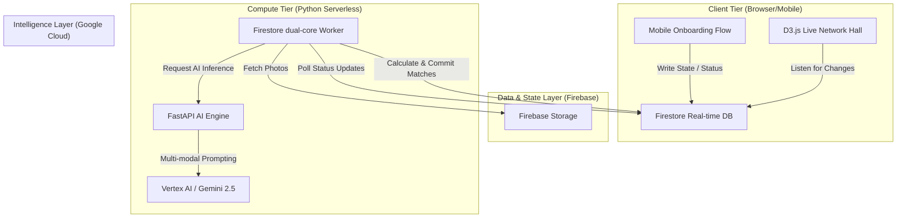

# Backend & System Architecture: Codebase Mapping

## 1. Project Structure
- **Root Level (`/`)**
  - Next.js configuration (`next.config.ts`, `tailwind.config.ts`)
  - Firebase configuration (`firestore.rules`, `firebase.json`, `firestore.indexes.json`)
  - AI & Backend Python workers (`main.py`, `firestore_worker.py`)
- **Frontend Source (`/src`)**
  - `/app`: Next.js App Router entry points (e.g., `/hall`, `/room`).
  - `/components`: Segmented UI layers (d3 `hall/`, responsive `mobile/`, wrapper `motion/`, reusable `ui/`).
  - `/context`: Client-side state management (e.g., Onboarding).
  - `/hooks`: Custom React Hooks for real-time Firestore synchronization (`useParticipant`, `useRoomParticipants`).
  - `/lib`: Helper utilities, Firebase initialization, and language mappings (`translations.ts`).

## 2. Key Modules & Services
- **Client Application (Next.js / React)**
  - Event Hall View (Desktop): D3.js real-time matchmaking network visualization.
  - User Mobile View: Framer Motion animated participant onboarding.
- **Backend / Real-time Engine (Python + Firestore)**
  - `firestore_worker.py`: Background orchestrator handling I/O and matching compute.
  - `main.py`: Core AI inference module (FastAPI/Vertex AI) processing multi-modal/tag data.
  - *Firestore*: The central asynchronous queue and global state layer coupling the dual-core system.

## 3. Data Flow Entry Points
- **Client-to-Database**: Users interact via mobile UI, mutating their document state (e.g., `waiting_for_ai`) in Firestore.
- **Database-to-Worker**: `firestore_worker.py` detects state changes and fetches required participant context.
- **Worker-to-AI**: Python backend bridges data to Vertex AI, calculates matchmaking matrices, and updates participant documents.
- **Database-to-Client**: React hooks (`useParticipant`, `useRoomParticipants`) reactively sync backend changes back to the UI, triggering animations and component mounts.

## 4. External Integrations
- **Google Cloud / Firebase**: Firestore (Real-time NoSQL layer), Firebase Auth/Hosting.
- **Vertex AI (Gemini)**: Multi-modal profiling and prompt generation system.

- **Client Rendering Libraries**: D3.js (Force-directed network rendering), Framer Motion (Lifecycle UI transitions).

## 5. Concept & Story

### 🌍 Brand New "Hello World."
For decades, "Hello World" has been a developer's first interaction with a machine. In the AI era, we redefine it as the machine facilitating a human's first interaction with another human.

Networking events and hackathons are full of brilliant people who hesitate to say "hello" because of social friction. **Nexus Connect** is a Brand New "Hello World" for human connection—an immersive, real-time platform that uses AI to eliminate awkwardness, instantly visualize relationships, and hand you the perfect conversation starter. It transforms a room of strangers into a living, interconnected network.

### 🧠 Concept & Story
Post-pandemic, we crave real-world connections but often lack the conversational bridge to initiate them. We built Nexus Connect to solve the "standing awkwardly near the snacks" problem. By offloading the cognitive load of finding common ground to Vertex AI, participants can bypass small talk and jump straight into meaningful, high-value conversations. It's a social catalyst designed for scale.

### 💡 What Makes This "Brand New"
- **Dual-View Architecture**: Separates the Event Hall View (a high-performance D3.js spatial network visualized on a large monitor) from the Participant View (a lightweight, Framer Motion-driven mobile UI).
- **Context-Aware Ice Breaking**: Not just matching tags. Gemini AI dynamically interrogates users based on their mood and generates exactly 3 bespoke conversation topics for every matched pair.
- **Real-Time Visual Feedback**: The moment a user completes onboarding, their node physically "drops" into the global D3.js network graph on the main screen, instantly tethering to their best matches.

---

---

## Step 2: Technical Architecture Breakdown

### 1. Frontend Architecture & Components
- **Framework**: Next.js 15 (App Router) with TailwindCSS and Framer Motion.
- **Real-time Synchronization**: Powered by Firebase Firestore SDK `onSnapshot` listeners integrated into custom React Hooks (`useParticipant`, `useRoomParticipants`).
- **Core Component Layers**:
    - **Live Network Hall (`/hall`)**: A high-performance D3.js force-directed graph rendering real-time participant nodes and affinity links based on live Firestore updates.
    - **Participant Onboarding (`/room`)**: A mobile-first, multi-step interface utilizing `Framer Motion` for lifecycle transitions (Entry → Mood/Camera → Questions → Profile).
    - **State Management**: `OnboardingContext` (React Context + Zustand) maintains local participant state and session persistence across onboarding steps.

### 2. Backend Architecture & Logic
- **Dual-Core Processing Model**:
    - **Orchestration Worker (`firestore_worker.py`)**: A multi-threaded Python polling service that monitors the "Event Bus" (Firestore). It handles I/O, image fetching from Cloud Storage, and coordinates multi-step matchmaking calculations.
    - **AI Compute Engine (`main.py`)**: A FastAPI-based service bridging to Google Vertex AI (Gemini 2.5 Flash). It performs stateless, heavy-duty inference:
        - **Multi-modal Analysis**: Extracting social cues and "vibe" from participant selfies.
        - **Icebreaker Generation**: Dynamic prompting based on Mood and initial OCEAN vectors.
        - **Profile Forging**: Final "Nexus Matrix" vector calculation and semantic tag generation.
- **Matchmaking Algorithm**: A hybrid scoring model calculating affinity as:
    - `70% Nexus Matrix Distance` (5-axis personality vector)
    - `30% AI Tag Similarity` (Semantic overlap scored by LLM)

### 3. Technical Data Flow
1. **Trigger**: Client updates Firestore document status to `generating_questions`.
2. **Pick-up**: `firestore_worker` detects the change, downloads the user's selfie, and hits the AI Engine.
3. **Inference 1**: AI Engine generates context-aware questions and a visual "vibe" analysis.
4. **Handoff**: Worker writes questions back to Firestore and sets status to `answering`.
5. **Submission**: Client submits answers, triggering `waiting_for_ai`.
6. **Inference 2**: AI Engine calculates the `final_vector` and semantic `tags`.
7. **Mesh Matching**: Worker performs a full-mesh affinity calculation against all `ready` participants in the room.
8. **Resolution**: Worker commits `affinities` and `matchedParticipant` data. Client UI reactively triggers terminal state (Profile Card / D3 Linkage).

### 4. Entire System Diagram

